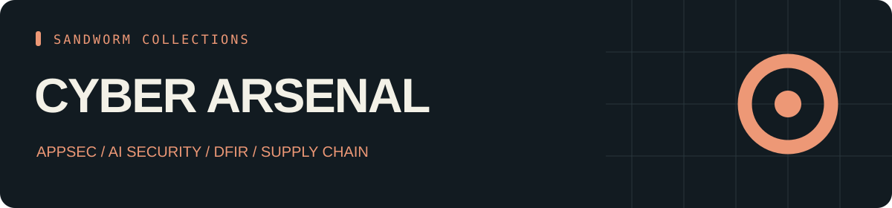

<p align="center"></p>

<p align="center"><b>68 skill entries · 17 tools · 32 source repositories</b></p>

# Sandworm Cyber Arsenal

A focused security collection covering AppSec, agent and MCP security, reverse engineering, DFIR, detection, and supply-chain review.

คลัง Cyber ที่รวม AppSec, AI/MCP security, reverse engineering, DFIR, detection และ supply-chain review

[ภาษาไทย](README.th.md) · [Skills](CATALOG.md) · [Tools](TOOLS.md) · [Start here](docs/start-here.md) · [Sources](SOURCES.md) · [Collection hub](https://github.com/Sandworm-Lazarus/sandworm-arsenal)

## What is inside

| Track | Entries |
| --- | ---: |
| Cyber | 46 |
| AI Security | 17 |
| Reverse / DFIR | 5 |

| Tool category | Projects |
| --- | ---: |
| Skill review | 2 |
| AI evaluation | 5 |
| Secrets | 1 |
| Containers / IaC | 2 |
| Supply chain | 4 |
| CI security | 1 |
| Code analysis | 2 |

## Use the collection

Browse the pinned source links and use the task paths in [Start here](docs/start-here.md). The offline CLI requires Python 3.9+ and no third-party dependencies.

```bash
git clone https://github.com/Sandworm-Lazarus/sandworm-cyber-arsenal.git
cd sandworm-cyber-arsenal
python3 scripts/arsenal.py search "" --json
python3 scripts/arsenal.py tools "" --json
python3 scripts/arsenal.py stats
python3 scripts/arsenal.py check
```

On Windows, use `py -3` if `python3` is unavailable.

## Evidence and reuse

Entry and Overview labels retain the inspection scope from the original research. Tool records are README overviews. No upstream installation, runtime certification, or benchmark result is claimed. [Review coverage](docs/review-status.md) records this collection's counts.

Original summaries, artwork, CLI and guides are [MIT licensed](LICENSE). Linked projects retain their own licenses; inspect [source/license notes](SOURCES.md) before copying or deploying external packages. This collection contains original curation and links, not upstream bundles.

## Related collections

- [AI Toolbox](https://github.com/Sandworm-Lazarus/sandworm-ai-toolbox)
- [Agent Skills](https://github.com/Sandworm-Lazarus/sandworm-agent-skills)
- [LLM Lab](https://github.com/Sandworm-Lazarus/sandworm-llm-lab)
- [Dev Playbooks](https://github.com/Sandworm-Lazarus/sandworm-dev-playbooks)

Selections overlap where tools support multiple tasks. Do not add collection counts together to infer a unique total.
